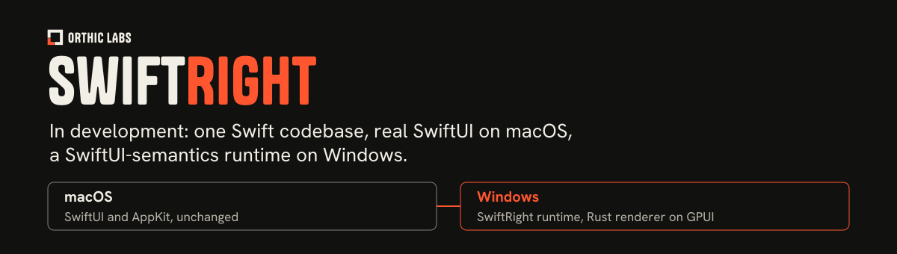

# SwiftRight

A Swift desktop application SDK for macOS & Windows, in development: one SwiftUI codebase, actual SwiftUI/AppKit on Mac & a SwiftRight-owned SwiftUI-semantics runtime on Windows, drawn by a Rust renderer on GPUI 0.2.2 with AccessKit.

**Status:** Work is paused since 11 October 2026. SR0 remains open: the Windows renderer, bridge, runtime & SliceApp build and run, and tuple 11 is built and receipted (fixture matrix 320/320; Mac-oracle cross-compare 16/16, with 0 unallowed differences and 69 fault controls rejected). BridgeSmoke recorded 40/40 smoke, 41/41 timeout and 10/10 pixel assertions. The slice contract is not frozen, the Windows MSIX fails interrupted-update check W08, and pending decisions remain; this is not a released SDK or a claim of complete SwiftUI compatibility ([PENDING](PENDING.md); [SR0 status](docs/sr0-status.md); [tuple 11 snapshot](docs/sr0-snapshot.md); [cross-compare evidence](probes/sr0-o/f1-cross/CROSS-ALL.md)).

## How it will work

- On macOS, SwiftRight types will be SwiftUI's own types, with a direct AppKit escape hatch.
- On Windows, a SwiftRight-owned runtime will own identity, state lifetime, dependency tracking, bindings, environment, layout proposals, transactions and lifecycle, and will render through a versioned C ABI to the Rust renderer. GPUI is the first renderer; Slint remains an unqualified alternative. UI Automation accessibility is a prerequisite, not an assumption.
- Existing Rust engines will keep working: on Windows they load in-process as separate versioned DLLs behind their own C ABI, so a UI-only change does not rebuild the rendering stack.
- Parity will be a tested contract, never a promise. Every API in the published inventory will have a compile fixture, a behavioural trace recorded on macOS and a Windows replay; unsupported APIs will fail at Windows compile time.
- No compiler fork, no transpiler, no emulator for macOS binaries, no native WinUI controls, no second-language shell, and no AI service or network connection to render UI.

Source for each point: [architecture](docs/architecture.md), section 1 (product definition and hard requirements) and section 3 (architecture decisions AD2 to AD8).

## Architecture

Read [SwiftRight architecture v0.5](docs/architecture.md), dated 8 October 2026, & [review history with v0.5 dispositions](docs/architecture-review.md#v05-sequential-adversarial-review-8-october-2026). The Windows renderer is a Rust cdylib on GPUI 0.2.2, AccessKit 0.25.1 & accesskit_windows 0.35.1, exposed to Swift through a versioned C ABI (0.6) consumed by [SwiftRightBridge](packages/SwiftRightBridge/). The packaged example records its renderer pin in [renderer-pin.json](examples/SliceApp/Windows/renderer-pin.json). GPUI is the first renderer; Slint remains an unqualified alternative. UIA, IME & Narrator paths are exercised by the SR0 native-interaction probes, and known limitations are listed in [SR0 status](docs/sr0-status.md).

The plan covers package boundaries, native backends, state and binding semantics, platform services, existing Rust-engine reuse, tooling, packaging, migration, conformance tests, performance measurements, and long-term maintenance.

## Targets

Qualified targets are macOS 14 or later on Apple Silicon & Windows 11 x64 ([SR0 status](docs/sr0-status.md), scope revision 1). Windows arm64 & Intel Macs are unsupported. The recorded hosts use Swift 6.4 on both platforms ([SR0 snapshot](docs/sr0-snapshot.md)).

## Delivery sequence

| Gate | Required outcome | State |
| --- | --- | --- |
| SR0 | Qualify dependencies/hosts; freeze slice & budgets; establish repeatable Mac oracle; prove layout/bridge; compare seeds; qualify signed packages & local automation. Failures route to their owning layer; Slint must qualify before fallback use. | Open: receipts on tuple 11; freeze, W08 & listed decisions pending ([docs/sr0-status.md](docs/sr0-status.md)) |
| SR1 | Inventory contract: compile fixtures, macOS traces, Windows replays; unsupported APIs fail at Windows compile. | Factory draft specifications & spikes in [factory/](factory/README.md); nothing promoted |
| SR2 | Deliver a complete desktop utility with persistence, native services, and installable packages. | Not started |
| SR3 | Migrate one real feature against an existing engine, retaining a rollback path. | Not started |
| SR4 | Pass measured performance, reliability, clean-install, and update requirements. | Not started |
| SR5 | Support a second independent application and publish contributor and compatibility guidance. | Not started |

The full plan defines acceptance criteria and platform boundaries for each gate. Preserve native platform extensions and working Rust engines; do not require a compiler fork, transpiler, browser-based controls, second-language shell, or runtime AI access. SwiftRight remains independent of [RustRight](https://github.com/bogusyogi/rustright).

## Layout

| Path | Contents |
| --- | --- |
| [docs/](docs/) | Architecture, SR0 status, findings, snapshot, retry ledger & the SR1 plan |
| [examples/SliceApp/Windows/renderer-pin.json](examples/SliceApp/Windows/renderer-pin.json) | Renderer pin for the packaged Windows example |
| [packages/SwiftRightBridge/](packages/SwiftRightBridge/) | Swift bridge to the renderer ABI |
| [packages/SwiftRightServices/](packages/SwiftRightServices/) | Swift client for Rust engines on the RightKit framed-sidecar wire |
| [examples/](examples/) | SliceApp (packaged example), BridgeSmoke, BridgeGeoModal |
| [probes/](probes/) | SR0 probe projects & results |
| [factory/](factory/README.md) | SR1 factory specifications, tools & spikes (draft) |
| [docs/qualification.md](docs/qualification.md) | Qualification runner, receipts & outputs |
| [conformance/](conformance/) | SR0 slice contract (draft) with accepted & candidate recordings |

SwiftRight owns UI semantics & Swift adapters; RightKit supplies existing shared capabilities, managed Rust builds & release machinery. This repository qualifies on local native hosts, without GitHub Actions.

## Licence

SwiftRight is licensed under the [Apache License 2.0](LICENSE). Third-party components keep their own licences; see [NOTICE](NOTICE).

---

<picture><source media="(prefers-color-scheme: dark)" srcset=".github/orthic-labs-mark.svg"></picture> **[Orthic Labs](https://orthiclabs.com)** · [github.com/Orthic-Labs](https://github.com/Orthic-Labs) · More: [Legion](https://github.com/Orthic-Labs/legion) · [SellRight](https://github.com/Orthic-Labs/sellright) · [Ember](https://github.com/Orthic-Labs/ember) · [Pulse](https://github.com/Orthic-Labs/pulse) · [RightKit](https://github.com/Orthic-Labs/rightkit) · [RustRight](https://github.com/Orthic-Labs/rustright)
